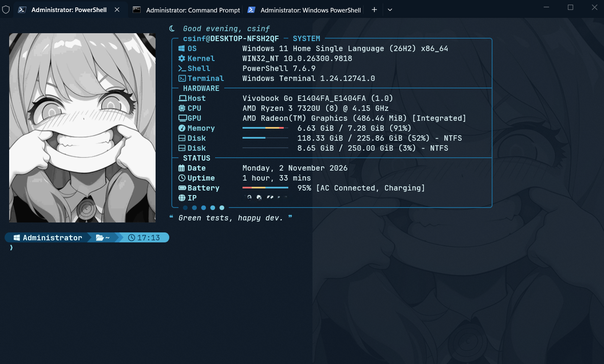
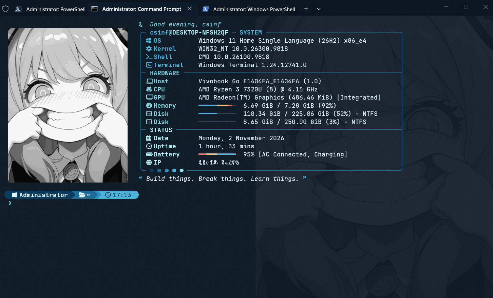

# Shell Senpai

Notice me, Shell Senpai. Kalimat itu mungkin terdengar bercanda, tapi memang begitulah awal proyek ini. Terminal bawaan Windows itu fungsional, tapi tampilannya datar dan membosankan. Layar hitam, tulisan putih, dan prompt yang cuma menampilkan path panjang tanpa konteks apa pun. Shell Senpai lahir dari keinginan sederhana untuk punya terminal yang enak dilihat setiap kali dibuka, tetap informatif untuk kerja sehari hari, dan terasa seperti markas sendiri, layaknya lobby game yang sudah kamu kustom habis habisan sebelum masuk ke match.

Repo ini berisi seluruh dotfiles yang saya pakai di Windows Terminal. Tiga shell sekaligus ikut diupgrade di sini, yaitu PowerShell 7, Windows PowerShell 5.1, dan Command Prompt. Semuanya disimpan di satu tempat supaya kalau suatu hari laptop harus diinstal ulang, saya cukup clone repo ini dan dalam beberapa menit semuanya kembali seperti semula. Anggap saja ini save file untuk terminal kamu.

## Preview

Daripada panjang lebar menjelaskan, lebih baik lihat langsung hasilnya. Tangkapan layar pertama adalah PowerShell 7 yang menjadi shell utama saya sehari hari.



Selanjutnya ada Windows PowerShell 5.1, versi bawaan Windows yang ternyata bisa tampil sama kerennya berkat profile yang dipakai bersama.


Terakhir ada Command Prompt, shell paling klasik yang biasanya polos tanpa warna, tapi di sini ikut naik level berkat bantuan Clink.



## Tentang Proyek Ini

Shell Senpai bukan aplikasi baru, melainkan kumpulan konfigurasi yang menyatukan beberapa tools open source menjadi satu tampilan yang konsisten. Fastfetch dipakai untuk menampilkan informasi sistem, Starship untuk prompt, Clink untuk menghidupkan Command Prompt, dan sisanya adalah script PowerShell buatan sendiri yang mewarnai output command sehari hari. Semuanya dibalut tema Ocean Deep dengan gradasi biru laut yang kalem di mata, cocok untuk sesi ngoding panjang sampai lupa waktu.

Yang membuat proyek ini menarik adalah konsistensinya. Mau membuka PowerShell 7, Windows PowerShell versi lama, atau Command Prompt, tampilan yang menyambut kamu tetap sama persis. PowerShell memakai profile yang sama untuk kedua versinya, sedangkan Command Prompt diberi kekuatan tambahan lewat Clink yang menjalankan script Lua untuk menampilkan panel dan prompt yang identik.

## Fitur Utama

Saat terminal dibuka, hal pertama yang muncul adalah sapaan yang menyesuaikan jam, jadi pagi hari akan menyapa dengan Good morning dan malam hari berganti menjadi Good evening atau Good night lengkap dengan ikon matahari atau bulan. Tepat di bawahnya ada panel informasi sistem berbentuk kotak yang membagi data ke dalam tiga bagian, yaitu System, Hardware, dan Status. Penggunaan memori, disk, dan baterai ditampilkan dengan progress bar yang warnanya otomatis berubah menjadi kuning ketika mulai penuh dan merah ketika sudah kritis, mirip HP bar yang memberi peringatan sebelum karakter kamu tumbang. Di samping panel itu ada logo bergambar yang bisa diganti dengan waifu, husbando, atau foto apa pun yang kamu suka. Di bagian paling bawah muncul satu quote random dari kumpulan seratus quote berbahasa Inggris seputar dunia IT yang kadang bijak dan kadang cuma bikin senyum.

Prompt yang dipakai adalah Starship dengan gaya powerline. Prompt ini menampilkan user, folder aktif, branch Git, versi Python atau Node ketika sedang berada di folder proyek, serta jam. Kalau sebuah command berjalan lebih dari dua detik, prompt juga akan memberi tahu berapa lama command itu berjalan, jadi kamu selalu tahu berapa lama cooldown yang baru saja terlewati.

Selain tampilan, ada beberapa upgrade yang terasa saat dipakai bekerja, khususnya di PowerShell. Perintah dir dan ls sekarang menampilkan ikon dan warna yang berbeda untuk setiap jenis file, ukuran yang mudah dibaca, jumlah isi setiap folder, dan waktu relatif seperti 2h ago. Perintah ping memberi warna pada latency sehingga koneksi yang lambat langsung kelihatan, persis seperti indikator ping saat main online. Perintah tracert, ipconfig, dan nslookup juga ikut diwarnai agar informasi pentingnya menonjol. Ada juga perintah tree untuk melihat struktur folder secara bercabang, zoxide untuk teleport ke folder hanya dengan mengetik potongan namanya, serta prediksi command dari history yang muncul berwarna abu abu ketika mengetik. Command Prompt pun tidak ketinggalan, karena Clink memberinya autocomplete yang lebih pintar dan history yang tersimpan antar sesi.

## Struktur Repo

Folder fastfetch berisi template panel informasi beserta daftar quote. Folder starship menyimpan konfigurasi prompt yang dipakai bersama oleh ketiga shell. Folder powershell menyimpan profile dan script pewarna output yang berlaku untuk PowerShell 7 maupun Windows PowerShell 5.1. Folder clink berisi script Lua untuk Command Prompt, dan folder windows-terminal menyimpan tema Ocean Deep beserta seluruh pengaturan Windows Terminal.

## Instalasi

Pertama, pastikan semua tools yang dibutuhkan sudah terpasang. Jalankan perintah berikut di PowerShell, lalu tutup dan buka ulang Windows Terminal setelah selesai.

```powershell
winget install Microsoft.PowerShell
winget install Git.Git
winget install DEVCOM.JetBrainsMonoNerdFont
winget install Fastfetch-cli.Fastfetch
winget install Starship.Starship
winget install ajeetdsouza.zoxide
winget install junegunn.fzf
winget install chrisant996.Clink
```

Selanjutnya, buka PowerShell 7 lalu clone repo ini ke komputer kamu.

```powershell
git clone https://github.com/NullIvy/shell-senpai.git
cd shell-senpai
```

Setelah itu, salin semua konfigurasi ke tempatnya masing masing. Perintah di bawah ini sekaligus menghubungkan profile PowerShell 7 dan Windows PowerShell 5.1 ke file yang sama, sehingga keduanya selalu tampil identik.

```powershell
Set-ExecutionPolicy -Scope CurrentUser RemoteSigned -Force
New-Item -ItemType Directory -Force "$HOME\.config\fastfetch", "$HOME\.config\powershell", "$env:LOCALAPPDATA\clink" | Out-Null
Copy-Item .\fastfetch\* "$HOME\.config\fastfetch\" -Force
Copy-Item .\starship\starship.toml "$HOME\.config\starship.toml" -Force
Copy-Item .\powershell\colors.ps1 "$HOME\.config\powershell\colors.ps1" -Force
Copy-Item .\powershell\profile.ps1 "$HOME\.config\powershell\profile.ps1" -Force
$docs = Split-Path (Split-Path $PROFILE)
New-Item -ItemType Directory -Force "$docs\PowerShell", "$docs\WindowsPowerShell" | Out-Null
Set-Content "$docs\PowerShell\Microsoft.PowerShell_profile.ps1" ". `"$HOME\.config\powershell\profile.ps1`""
Set-Content "$docs\WindowsPowerShell\Microsoft.PowerShell_profile.ps1" ". `"$HOME\.config\powershell\profile.ps1`""
Copy-Item .\clink\*.lua "$env:LOCALAPPDATA\clink\" -Force
Copy-Item .\windows-terminal\settings.json "$env:LOCALAPPDATA\Packages\Microsoft.WindowsTerminal_8wekyb3d8bbwe\LocalState\settings.json" -Force
$tpl = "$HOME\.config\fastfetch\template.jsonc"
$logo = "$HOME\.config\fastfetch\logo-bw.png".Replace('\', '/')
[IO.File]::WriteAllText($tpl, [IO.File]::ReadAllText($tpl).Replace('__LOGO__', $logo))
clink autorun install
```

Langkah berikutnya adalah memilih karakter untuk logo kamu. Gambar logo sengaja tidak disertakan di repo ini, jadi simpan gambar pilihan kamu sendiri sebagai logo-bw.png di folder .config\fastfetch. Gambar dengan orientasi potret dan wajah yang cukup besar biasanya memberikan hasil paling bagus. Terakhir, tutup semua jendela Windows Terminal lalu buka lagi, dan Shell Senpai akan langsung menyambut kamu di tab mana pun yang kamu buka.

## Kustomisasi

Hampir semua bagian Shell Senpai bisa dimodifikasi sesuai selera, layaknya skin dan loadout di game favoritmu. Kalau ingin menambah quote, cukup buka quotes.txt lalu tulis satu quote di setiap baris. Warna prompt bisa diganti di starship.toml dengan mengubah kode hex di bagian style, sedangkan warna output command seperti ping dan dir diatur dari variabel C di bagian paling atas colors.ps1. Untuk mengganti logo, tinggal timpa file logo-bw.png dengan gambar baru lalu ketik cls, dan tampilan baru akan langsung muncul di ketiga shell.

## Penutup

Proyek ini awalnya cuma iseng karena bosan melihat terminal yang itu itu saja, tapi ternyata terminal yang enak dilihat bikin saya jauh lebih betah ngoprek berlama lama. Kalau kamu menemukan bug atau punya ide untuk membuatnya lebih keren, silakan buka issue atau kirim pull request, karena party yang lengkap selalu lebih seru daripada solo queue. Semua tools yang dipakai di sini adalah proyek open source luar biasa, jadi kredit sepenuhnya untuk para pembuat Fastfetch, Starship, Clink, zoxide, dan fzf.

Dibuat dengan secangkir kopi dan terlalu banyak kali mengetik cls oleh Rizki. GG and have fun.
