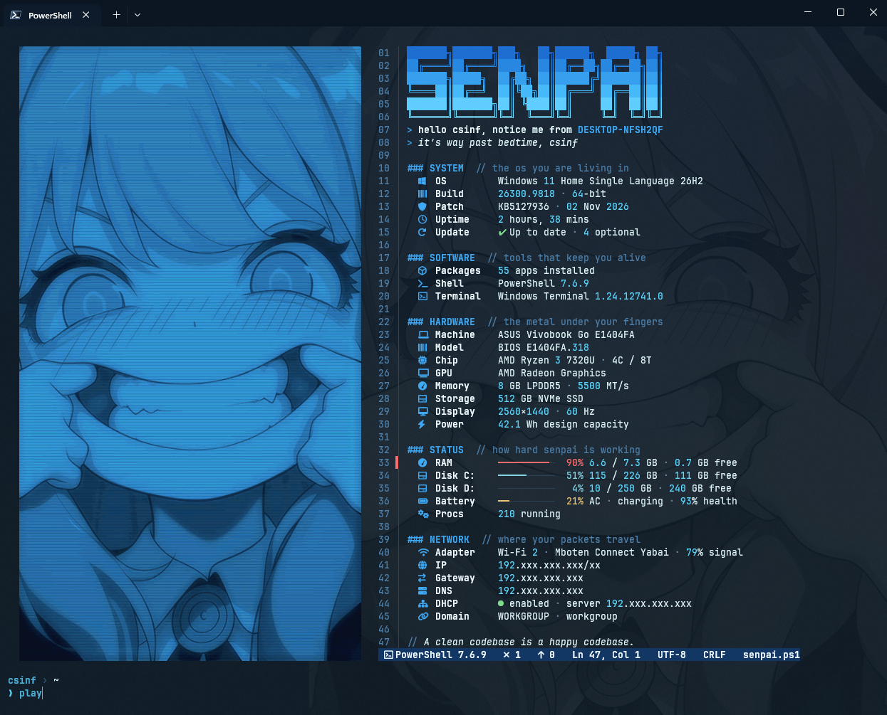
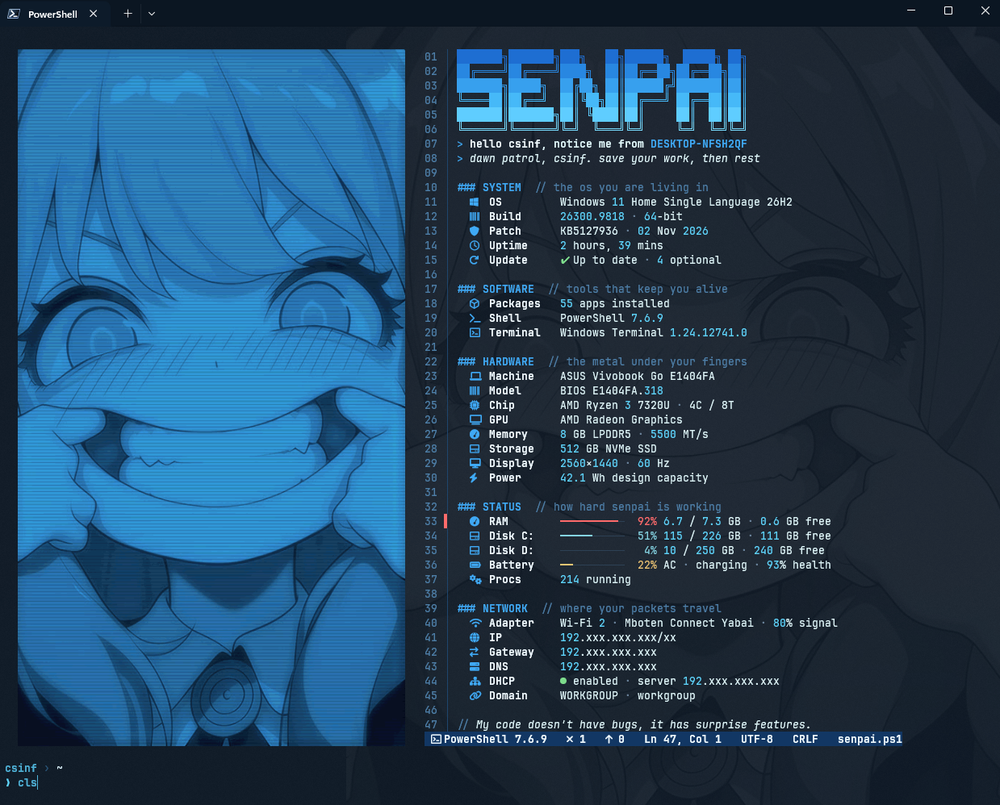
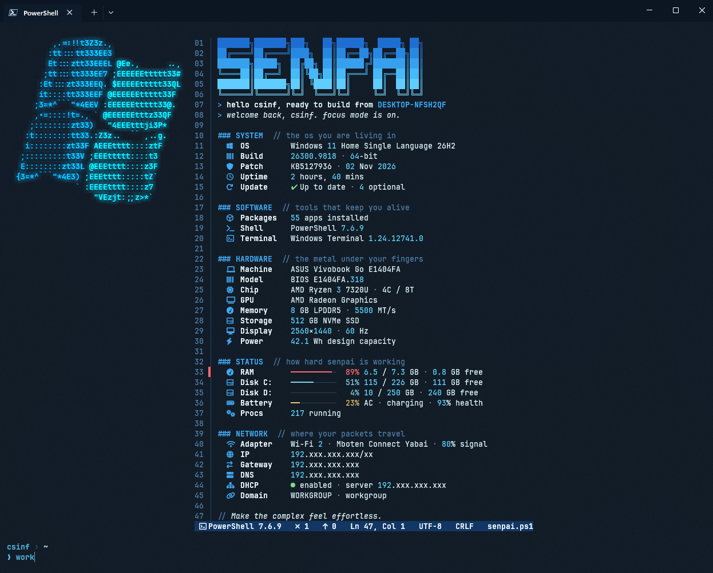
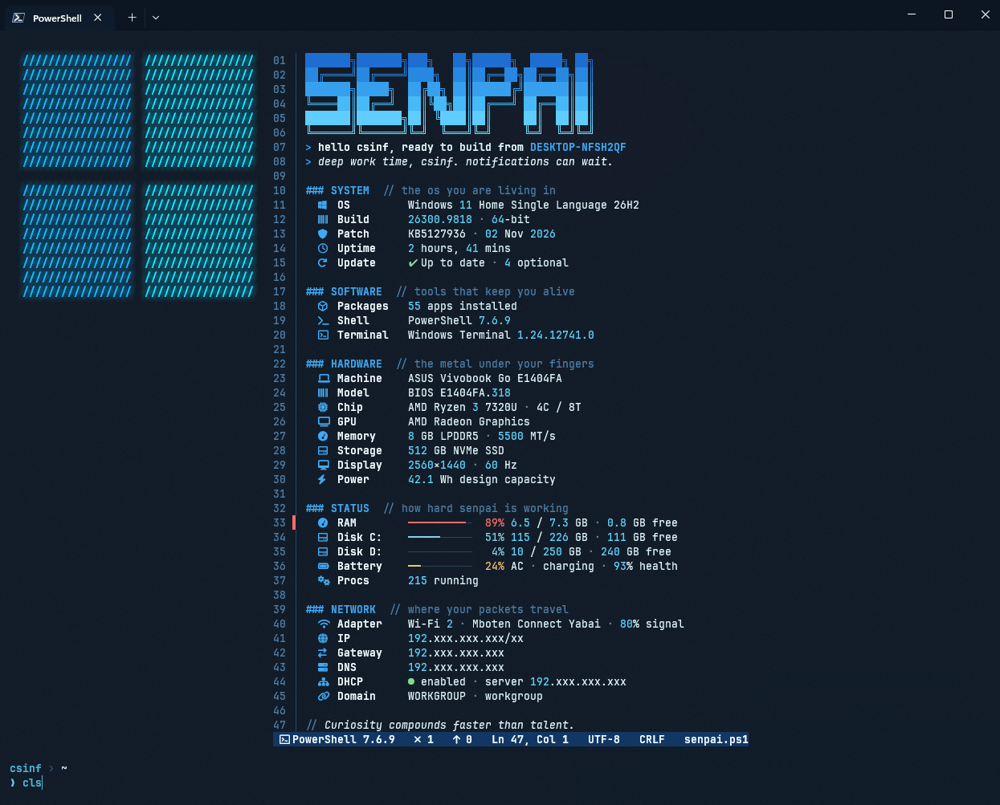

# Shell Senpai

Notice me, Shell Senpai. Proyek ini dimulai dari rasa bosan melihat terminal Windows yang datar, lalu tumbuh jadi markas kecil yang terasa personal setiap kali dibuka. Versi pertamanya berbentuk kartu bertema Ocean Deep, dan sekarang Shell Senpai masuk ke edisi kedua yang saya sebut Neon IDE Edition. Kalau versi Mac saya yang bernama Sugeng Slay terasa seperti layar HUD di game cyberpunk, edisi Windows ini sengaja dibuat terasa seperti code editor milik programmer, lengkap dengan nomor baris, judul section ala markdown, komentar kode, dan status bar seperti di VS Code.

Repo ini berisi seluruh dotfiles yang saya pakai di Windows Terminal untuk PowerShell 7, Windows PowerShell 5.1, dan Command Prompt. Ketiganya menampilkan panel yang sama persis karena semuanya memanggil satu script yang sama. Semua konfigurasi disimpan di sini supaya kalau laptop harus diinstal ulang, saya cukup clone repo ini dan dalam beberapa menit semuanya kembali seperti semula. Versi kartu yang lama tetap bisa diambil lewat tag v1.0.

## Preview

Dua tangkapan layar pertama adalah mode play, yaitu tampilan santai dengan foto karakter bernuansa neon biru di samping panel. Sapaan dan quote di bawahnya selalu berganti setiap kali panel digambar ulang.





Dua tangkapan layar berikutnya adalah mode work, yaitu tampilan yang lebih netral untuk kantor. Logo Windows dipilih secara acak setiap kali layar dibersihkan, lalu ditemani kalimat motivasi kerja.





Kalau penasaran dengan edisi pertama yang bertema Ocean Deep, tangkapan layarnya masih tersimpan di [pwsh7.png](screenshots/pwsh7.png), [windows-powershell.png](screenshots/windows-powershell.png), dan [cmd.png](screenshots/cmd.png).

## Tentang Edisi Ini

Shell Senpai bukan aplikasi baru, melainkan kumpulan konfigurasi yang menyatukan beberapa tools open source menjadi satu tampilan yang konsisten. Fastfetch dipakai untuk menggambar logo dan panel, Starship mengurus prompt, Clink menghidupkan Command Prompt, sedangkan semua data di panel dikumpulkan oleh satu script PowerShell bernama cyberdeck.ps1. Data yang jarang berubah seperti spesifikasi hardware disimpan di cache dan diperbarui sekali sehari, sementara pengecekan Windows Update berjalan diam diam di background setiap enam jam, jadi terminal tetap terbuka dengan cepat.

Ada satu prinsip yang saya pegang selama membangun edisi ini, yaitu efek visual tidak boleh mengorbankan kenyamanan mata. Efek glow neon hanya menyala di gambar, sedangkan teks panel tetap tajam tanpa bayangan. Pada mode play, glow dan scanline dicetak langsung ke dalam foto. Pada mode work, shader Windows Terminal hanya memberi cahaya pada piksel berwarna kunci yang dipakai logo Windows, sehingga teks di sebelahnya tidak ikut tersentuh.

## Fitur Unggulan

| Fitur | Penjelasan |
|---|---|
| Judul ASCII SENPAI | Judul besar bergradasi dari biru tua ke cyan neon di bagian paling atas panel |
| Nomor Baris | Setiap baris panel diberi nomor di gutter kiri seperti di code editor |
| Section ala Markdown | Setiap bagian dibuka dengan judul seperti ### SYSTEM lalu komentar singkat yang menjelaskan isinya |
| Status Bar ala VS Code | Baris penutup menampilkan shell, jumlah alert, update tertunda, posisi baris, encoding, dan nama file |
| Penanda Error di Gutter | Baris yang kritis seperti RAM penuh atau baterai lemah diberi penanda merah di gutter |
| Syntax Highlighting | Angka dan versi diwarnai berbeda supaya data lebih cepat dibaca |
| Hardware Otomatis | Model laptop, BIOS, CPU, GPU, RAM, SSD, layar, dan kapasitas baterai terdeteksi sendiri tanpa ditulis manual |
| Patch dan Update | Security patch yang terpasang dan status update yang angkanya sama dengan halaman Settings |
| Status Real Hardware | RAM, setiap drive, baterai beserta health, dan jumlah proses yang berjalan |
| Kartu Network | Adapter Wi-Fi, IP, gateway, DNS, status DHCP, dan domain atau workgroup |
| IP Tersamar | Semua alamat IP otomatis ditampilkan seperti 192.xxx.xxx.xxx/xx supaya aman saat screenshot dibagikan |
| Mode Work dan Play | Perintah work menampilkan logo Windows acak dan motivasi kerja, sedangkan play menampilkan foto karakter |
| Neon Ramah Mata | Glow hanya menyala di gambar sehingga teks tetap tajam |
| Prompt Breadcrumb | Prompt bergaya breadcrumb VS Code yang menampilkan user, folder, dan branch Git |
| CLI Modern | Menu Tab interaktif, pencarian history dengan Ctrl R, cat berwarna, top, df, git diff ala editor, dan perintah myip |
| Tiga Shell Satu Tampilan | PowerShell 7, Windows PowerShell 5.1, dan Command Prompt tampil identik |

## Struktur Repo

Folder powershell berisi cyberdeck.ps1 sebagai mesin panel, profile.ps1 sebagai titik masuk PowerShell, dan colors.ps1 yang mewarnai output command sehari hari. Folder fastfetch berisi koleksi quote santai, quote motivasi kerja, dan sapaan khusus mode work. Folder starship menyimpan prompt breadcrumb, folder clink berisi script yang membuat Command Prompt ikut memanggil panel yang sama, dan folder windows-terminal menyimpan pengaturan terminal beserta shader neon. Terakhir ada folder tools yang berisi make-logo.ps1 untuk mengubah gambar pilihanmu menjadi logo neon.

## Instalasi

Pertama, pasang semua tools yang dibutuhkan lewat winget, lalu tutup dan buka ulang Windows Terminal setelah selesai.

```powershell
'Microsoft.PowerShell','Git.Git','DEVCOM.JetBrainsMonoNerdFont','Fastfetch-cli.Fastfetch','Starship.Starship','ajeetdsouza.zoxide','junegunn.fzf','chrisant996.Clink','sharkdp.bat','dandavison.delta','aristocratos.btop4win','muesli.duf','tldr-pages.tlrc' | ForEach-Object { winget install --id $_ -e --accept-source-agreements --accept-package-agreements }
Install-Module PSFzf -Scope CurrentUser -Force
```

Selanjutnya, buka PowerShell 7 lalu clone repo ini ke komputer kamu.

```powershell
git clone https://github.com/NullIvy/shell-senpai.git
cd shell-senpai
```

Setelah itu, salin semua konfigurasi ke tempatnya masing masing. Perintah di bawah ini sekaligus menghubungkan PowerShell 7 dan Windows PowerShell 5.1 ke profile yang sama, lalu mengganti penanda lokasi folder di pengaturan Windows Terminal dengan folder home milikmu.

```powershell
Set-ExecutionPolicy -Scope CurrentUser RemoteSigned -Force
New-Item -ItemType Directory -Force "$HOME\.config\fastfetch", "$HOME\.config\powershell", "$HOME\.config\windows-terminal", "$env:LOCALAPPDATA\clink" | Out-Null
Copy-Item .\fastfetch\* "$HOME\.config\fastfetch\" -Force
Copy-Item .\powershell\* "$HOME\.config\powershell\" -Force
Copy-Item .\starship\starship.toml "$HOME\.config\starship.toml" -Force
Copy-Item .\clink\*.lua "$env:LOCALAPPDATA\clink\" -Force
Copy-Item .\windows-terminal\*.hlsl "$HOME\.config\windows-terminal\" -Force
$docs = Split-Path (Split-Path $PROFILE)
New-Item -ItemType Directory -Force "$docs\PowerShell", "$docs\WindowsPowerShell" | Out-Null
Set-Content "$docs\PowerShell\Microsoft.PowerShell_profile.ps1" ". `"$HOME\.config\powershell\profile.ps1`""
Set-Content "$docs\WindowsPowerShell\Microsoft.PowerShell_profile.ps1" ". `"$HOME\.config\powershell\profile.ps1`""
$wt = "$env:LOCALAPPDATA\Packages\Microsoft.WindowsTerminal_8wekyb3d8bbwe\LocalState\settings.json"
(Get-Content .\windows-terminal\settings.json -Raw).Replace('__HOME__', $HOME.Replace('\', '\\')) | Set-Content $wt -Encoding utf8
clink autorun install
```

Langkah berikutnya adalah memilih gambar untuk logo mode play. Gambar sengaja tidak disertakan di repo ini, jadi pilih gambar favoritmu sendiri lalu jalankan make-logo.ps1. Script ini otomatis memotong gambar menjadi potret ramping, mengubahnya menjadi warna neon biru, lalu mencetak efek glow dan scanline ke dalamnya. Gambar dengan wajah yang cukup besar biasanya memberikan hasil paling bagus.

```powershell
.\tools\make-logo.ps1 -Source "C:\lokasi\gambar-pilihanmu.png"
```

Terakhir, tutup semua jendela Windows Terminal lalu buka lagi. Pembukaan pertama butuh sekitar dua detik karena data hardware sedang dikumpulkan, dan setelah itu Shell Senpai akan langsung menyambutmu di tab mana pun.

## Cara Pakai

Ada beberapa perintah yang akan sering kamu pakai. Perintah work mengganti panel ke mode kantor dengan logo Windows acak dan kalimat motivasi kerja, sedangkan play mengembalikan foto karakter. Mode yang dipilih tersimpan, jadi tetap terpakai saat terminal dibuka lagi. Perintah cls atau clear menggambar ulang panel dengan sapaan dan quote baru. Kalau sedang butuh melihat alamat IP asli, misalnya saat praktikum jaringan, jalankan $global:CDShowIP = $true lalu cls, dan untuk menyamarkannya lagi cukup ganti true menjadi false. Perintah myip juga selalu menampilkan IP lokal dan publik secara lengkap.

## Kustomisasi

Hampir semua bagian Shell Senpai bisa dimodifikasi seperti skin dan loadout di game. Quote santai ada di fastfetch/quotes.txt, quote kerja ada di work-quotes.txt, dan sapaan mode work ada di work-greet.txt, masing masing satu kalimat per baris. Komentar di setiap section bisa diganti di fungsi card di dalam cyberdeck.ps1. Kekuatan glow logo Windows diatur dari angka pengali di neon-key.hlsl, sedangkan kekuatan glow foto diatur dari parameter Glow saat menjalankan make-logo.ps1. Kalau ingin mematikan animasi scan di awal, tambahkan $global:CDBoot = $false di profile.

## Penutup

Edisi ini lahir dari banyak trial and error, mulai dari teks yang berbayang, angka update yang tidak cocok dengan Settings, sampai logo yang menolak berganti. Semua itu justru membuat saya belajar bahwa tampilan yang keren harus tetap nyaman dipakai berjam jam. Kalau kamu menemukan bug atau punya ide untuk membuatnya lebih keren, silakan buka issue atau kirim pull request, karena party yang lengkap selalu lebih seru daripada solo queue. Kredit sepenuhnya untuk para pembuat Fastfetch, Starship, Clink, zoxide, fzf, PSFzf, bat, delta, btop4win, duf, dan tlrc yang membuat semua ini mungkin.

Dibuat dengan secangkir kopi dan terlalu banyak kali mengetik cls oleh NullIvy. GG and have fun.
